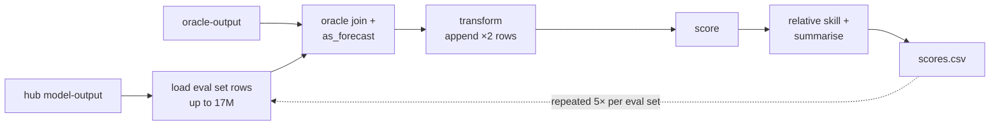
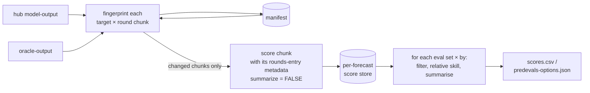

# Project Poster: Scalable evaluation computation

- Date: 2026-11-10

- Owner: Nicholas Reich

- Team: TBD

- Status: draft

## ❓ Problem space

### What are we doing?

Redesigning how hubverse evaluation scores are computed for the predevals dashboard (hubPredEvalsData → hubEvals → scoringutils), so that:

1. the cost of a dashboard build scales with *what changed* rather than with the size of the hub's whole history, and
2. a hub with more than one entry in the `rounds` array of `tasks.json` can define evaluation sets for each of those entries.

### Why are we doing this?

**Eval builds are hitting memory and time limits on real hubs.**

- The Reich Lab forecast sandbox (about 80 models, 2 targets, 12 eval sets) takes 2.5–3.5 h and peaks at 36 GB. The nightly "Rebuild Data" eval job has been killed for running out of memory (exit 137) on GitHub runners every night since 2026-10-13. We now build it by hand on the UMass Unity cluster, and the nightly workflow is disabled.
- The FluSight forecast hub has about the same amount of data per season as the sandbox (see below). Its eval build currently takes about 40 min and about 9 GB ([hubPredEvalsData#80](https://github.com/hubverse-org/hubPredEvalsData/issues/80)). This is a more prominent hub and any slowdown or complete issues here would be a larger problem than one on the sandbox.

**Why it's slow and big.** A [memory profile of the sandbox build](memory-profile.md) shows:

- **Peak memory is the largest eval set's working memory *plus* memory left over from earlier calls.**
  - The "three seasons, state level" set pools 17.0M quantile rows into one `hubEvals::score_model_out()` call, which needs about 26 GB on its own.
  - After that call returns, the R process does not give its memory back to the operating system: it stays at about 12 GB even though the live data are about 2.5 GB.
  - Every later call starts from that higher baseline, so the same work peaks 4–7 GB higher (28–32 GB), and the whole run peaks at 36 GB.
  - The baseline levels off (11.5–13 GB for the rest of the run) rather than growing without limit. But because of it, the order of eval sets matters: a big eval set that runs late inherits the memory left by every set before it.
  - Every other eval set peaks at 18 GB or less, mostly that retained baseline.
- **Within one call, the data are copied and reshaped many times:**

  | stage | memory | time |
  |---|---|---|
  | oracle join + `as_forecast_quantile()` | 3.8 → 11 GB | 67 s |
  | `transform_forecasts(append = TRUE)` (copies, doubles the rows, validates 6×) | → 21 GB | about 330 s |
  | `score()` (each metric reshapes the data again) | peaks at 26 GB | about 425 s |
  | relative skill + summary | | about 10 s |

- **The same work is repeated 5× per eval set**, once for the overall scores and once per disaggregation (location, reference_date, horizon, target_end_date). Each repeat starts from the retained baseline above.
- **Every run rescores everything,** including seasons that closed years ago.

**Sandbox vs FluSight: same data, different eval sets.**

| season | FluSight files / models / MB | sandbox files / models / MB |
|---|---|---|
| 2023-24 | 1128 / 43 / 407 | 1131 / 39 / 425 |
| 2024-25 | 1326 / 56 / 485 | 920 / 40 / 345 |
| 2025-26 | 1664 / 68 / 700 | 1967 / 72 / 772 |

- Rows scored per round (wk inc flu hosp, quantiles, states, horizons 0–3) are similar: FluSight 154k / 180k / 222k vs sandbox 187k / 191k / 268k.
- The two dashboards' configs are almost identical. The difference is that the sandbox has a multi-season eval set (17.0M rows), while FluSight's largest set is a single season (about 6M rows).
- Memory grows roughly linearly with the rows in the largest call: about 26 GB at 17M rows, about 9 GB at 6M.
- **The dimension that breaks things is "how many seasons an eval set pools", and today's design pays for it in full on every run.**

**`rounds` entries.** In `tasks.json`, the `rounds` array holds one or more entries ("`round` elements" in the [hubverse docs](https://docs.hubverse.io/en/latest/user-guide/tasks.html)). A *round* is a single modeling round, identified by a `round_id`.

- With `round_id_from_variable: true`, one entry defines **many rounds**, one per value of a task ID such as `reference_date`. The sandbox and FluSight both work this way: one entry spans several seasons.
- With `round_id_from_variable: false`, each entry is **one round**, as in scenario hubs.

predevals currently supports only hubs with a single `rounds` entry and `round_id_from_variable: true` ([PredEvals limitations](https://docs.hubverse.io/en/latest/user-guide/dashboards.html#predevals-limitations)). The config's `rounds_idx` ([hubPredEvalsData#26](https://github.com/hubverse-org/hubPredEvalsData/issues/26), [#28](https://github.com/hubverse-org/hubPredEvalsData/issues/28)) picks one entry, and that entry's metadata is applied to everything:

- target keys, output types, task ID values, target names and units;
- the `round_id` variable used by `round_filters`.

Loading does not filter rows by entry, so rows from other entries can be silently scored under the wrong metadata. A hub that adds a new entry (for example new targets, locations or output types for a new season) cannot have eval sets for it.

### What are we _not_ trying to do?

- Add new metrics, output types or transforms.
- Rewrite scoring math. scoringutils stays the reference implementation.
- Support eval sets that pool rounds from *different* `rounds` entries. This is noted as an open question below, not a goal.
- Build a general-purpose scoring database for ad hoc analysis. The store is an internal cache for dashboard builds, although it may turn out useful for that too.

### How do we judge success?

- A nightly incremental eval build for the sandbox fits on a standard GitHub runner (16 GB). Target: under 8 GB peak and under 1 h. These are estimates to be checked with benchmarks (see "What do we need to answer?").
- A full rebuild needs at least 4× less peak memory than today, and its peak no longer grows with the number of seasons an eval set pools.
- The output matches today's `scores.csv` files on the sandbox and FluSight, apart from deliberate fixes such as [hubEvals#162](https://github.com/hubverse-org/hubEvals/issues/162).
- A test hub with two `rounds` entries can define and display eval sets for each.
- Existing per-season and multi-season eval sets keep working without config changes.

### What are possible solutions?

1. **Incremental fixes to the current design** (in flight): load once and score once per eval set ([hubPredEvalsData#80](https://github.com/hubverse-org/hubPredEvalsData/issues/80), [#83](https://github.com/hubverse-org/hubPredEvalsData/issues/83), [#89](https://github.com/hubverse-org/hubPredEvalsData/issues/89)), plus upstream speedups. This cuts the time by about 5×, but the peak still grows with the size of the largest eval set.
2. **Round-chunked scoring with a stored per-forecast score store, updated incrementally** (proposed below). This makes memory independent of eval set size and rescores only what changed.
   - **Caveat:** relative skill can't be updated incrementally. It compares every model against the others across the whole eval set, so any change to a round in an eval set means recomputing that eval set's relative skill and summaries.
   - **What makes it worthwhile:** that recomputation runs on the stored per-forecast scores (about 1 row per forecast per scale), not on the quantile rows. For the largest sandbox eval set, relative skill took 8–18 s per disaggregation in the profile, vs about 14 min to rescore the quantile rows.
   - **Net effect:** a change triggers (a) rescoring of the affected round chunks only, and (b) re-summarising of every eval set that contains them. Eval sets for closed seasons are skipped entirely unless their data change.
3. **A faster scoring kernel** that computes WIS and coverage from one n × Q quantile matrix ([scoringutils#1237](https://github.com/epiforecasts/scoringutils/issues/1237)). It complements 1 and 2 by cutting the cost per row.
4. **Moving scoring into duckdb/arrow SQL over parquet.** This scales furthest, but it is a second implementation of the scoring rules and departs from the R-maintainable precompute in the [eval dashboard LDR](../../decisions/2024-12-13-ldr-eval-dashboard-structure.md).
5. **Bigger machines** (larger or self-hosted runners, a cluster). This is a stopgap; self-hosted runners conflict with the [GitHub Action security RFC](../../decisions/2025-02-13-rfc-github-action-security.md).

## ✅ Validation

### What do we already know?

- **Per-forecast scores are local.** WIS and its components, ae_median and interval coverage for a forecast depend only on that forecast's own quantiles and observed value. Any partition of the forecasts can be scored independently and the results concatenated.
- **Relative skill is not local, but it's cheap on scores.** It needs all models' scores for a group, but it runs on per-forecast scores (about 1 row per forecast per scale), not on quantile rows. `score_model_out(summarize = FALSE)` already returns per-forecast scores. Summarising them separately needs a public API ([hubEvals#143](https://github.com/hubverse-org/hubEvals/issues/143)). A reprex in [hubPredEvalsData#83](https://github.com/hubverse-org/hubPredEvalsData/issues/83) shows score-once results are identical to today's.
- **Where the time and memory go** (hubEvals 0.5.0, scoringutils 2.3.0):
  - the oracle `left_join` makes a full copy, and `as_forecast_quantile()` makes 2 more;
  - `transform_forecasts(append = TRUE)` makes about 4 copies at 2× rows and runs 6 validations ([scoringutils#1236](https://github.com/epiforecasts/scoringutils/issues/1236); fix in PR [#1238](https://github.com/epiforecasts/scoringutils/pull/1238), open);
  - `score()` reshapes the data into intervals 4× for WIS and its components, plus once per coverage level ([scoringutils#1237](https://github.com/epiforecasts/scoringutils/issues/1237), open, no PR).
- **Upstream work already landed:** pairwise comparisons pivot once ([scoringutils#1221](https://github.com/epiforecasts/scoringutils/issues/1221)); unused Wilcoxon tests removed ([#1222](https://github.com/epiforecasts/scoringutils/issues/1222), [#978](https://github.com/epiforecasts/scoringutils/issues/978)); picked up in [hubEvals#156](https://github.com/hubverse-org/hubEvals/pull/156) and hubPredEvalsData 1.3.0.
- **Known correctness bug:** relative skill ignores `scale` when `transform_append = TRUE` ([hubEvals#162](https://github.com/hubverse-org/hubEvals/issues/162)).
- **Open upstream request** from the hubverse: forecast counts from `summarize_scores()` ([scoringutils#1220](https://github.com/epiforecasts/scoringutils/issues/1220)).
- **Target data are revised.** NHSN values for recent weeks change for several weeks after first release, so the scores for recent rounds change even when no model output does.
- **Model output is rewritten after the fact,** for example the WISAR6 rerun ([forecast-sandbox#81](https://github.com/reichlab/forecast-sandbox-2025-2026/pull/81)) replaced past rounds' files.
- **The control room** (`hub-dashboard-control-room`, `generate-data.yaml`, job `build-evals`) runs a full rebuild on `ubuntu-latest` every time.

### What do we need to answer?

- **Storage:** where the score store and its manifest live (an orphan branch like `predevals/data`, or S3) and how big they are. Rough estimate for the sandbox: about 1.5M forecasts × 2 scales × about 6 metrics, so tens of MB as parquet.
- **Chunk size:** per round (about 260k rows this season) vs per round × target vs per model file. The trade-off is fixed per-call overhead against memory.
- **Change detection for target data:** how to fingerprint the oracle rows a chunk depends on, including hubs with versioned target data (`as_of`).
- **Cost of the summarise step:** 12 eval sets × 5 disaggregations × 2 targets of relative skill and summaries over the store. This needs benchmarking, since it sets the floor for the nightly runtime.
- **Compound and sample metrics:** these can be chunked only along task IDs outside the compound unit. Round always qualifies; does anything else?
- **Comparing across `rounds` entries:** if eval sets ever pool entries, what makes two entries comparable (same `target_id`, same units and output types)?
- **Front end:** should predevals keep reading `scores.csv`, or move to summary parquet and/or group eval sets by entry? Both are allowed if they help.
- **Upstream timelines:** epiforecasts (scoringutils) and the hubverse team (hubEvals, hubPredEvalsData).

## 👍 Ready to make it

### Proposed solution

Score each target's forecasts **one round at a time**, using that round's own `rounds` entry metadata, and keep the per-forecast scores in a **store** that is updated only for rounds whose model output, target data or scoring settings changed. Eval sets and disaggregations then become cheap filters and summaries over the store, and each eval set names the `rounds` entry it applies to.

### Visualize the solution

**Today:**

**Proposed:**

**1. Round-chunked scoring.**
- The unit of work is target × round: every model's file for one `round_id`.
- Each chunk looks up its `rounds` entry and uses that entry's target keys, output types and `round_id` variable.
- It joins to the oracle and calls `score_model_out(summarize = FALSE)`, on the natural and transformed scales.
- Peak memory follows the chunk size, about 260k rows for a current sandbox round vs 17M in one call today, regardless of how many seasons an eval set pools.

**2. Per-forecast score store and manifest.**
- **Score store:** scores are stored as parquet partitioned by target and round. Key: `round_id` + task IDs + `model_id` + `scale`.
- **Manifest:** a small table, saved next to the store, that records *what inputs each stored chunk was computed from*. It is the build's memory of the previous run. It has one row per chunk (target × `round_id`), for example:

  | target_id | round_id | rounds_entry | model_output_hash | oracle_hash | settings_hash | n_forecasts | scored_at |
  |---|---|---|---|---|---|---|---|
  | wk inc flu hosp | 2025-12-13 | 0 | `3f9a…` | `b21c…` | `77e0…` | 11,648 | 2026-11-10T03:12Z |

  - `model_output_hash` is a hash of the sorted list of (file path, git blob SHA) for every model-output file in that round. Adding, removing or changing any file changes it.
  - `oracle_hash` is a hash of the oracle rows the round's forecasts join to.
  - `settings_hash` is a hash of the metrics, transform and package versions.
  - The manifest holds no scores, just a few hundred rows for a hub with several seasons. It's what lets a run decide which chunks to rescore without reading the stored scores or the hub's git history.

**3. Change detection: score only when inputs change.** Each run computes fingerprints per chunk and rescores the chunks whose fingerprints differ from the manifest:
- **model output:** git blob SHAs of the round's model-output files, from `git ls-tree`. This is a content hash that needs no file reads.
- **target data:** a hash of the oracle rows the chunk's forecasts join to. Because recent target data are revised, the last several rounds will usually be rescored each week. That's expected and cheap.
- **scoring settings:** metrics, transform, and the hubEvals/scoringutils versions. A change here invalidates every chunk.

We compare fingerprints with a stored manifest, not git diffs since the last run. It doesn't depend on keeping the last-run commit or on history being linear. It survives squash merges, force pushes, shallow clones and bulk reruns, and it also covers oracle data that doesn't live in git.

Each run writes a summary of which chunks were rescored and why (new / model output changed / target data revised / settings changed). A periodic full rebuild checks that the incremental store matches a from-scratch build.

**4. Summarise layer.**
- For each eval set × `disaggregate_by`: filter the store, compute relative skill per group *and* scale (fixes [hubEvals#162](https://github.com/hubverse-org/hubEvals/issues/162)), then means and counts.
- Uses the public API from [hubEvals#143](https://github.com/hubverse-org/hubEvals/issues/143).
- Multi-season eval sets are just filters over more rounds.
- Output stays compatible with predevals by default. The format may change if that helps.

**5. Eval sets for multiple `rounds` entries** (config schema v1.2.0).
- Each eval set names the entry it applies to. This replaces the global `rounds_idx`, which defaults to entry 0 for backwards compatibility.
- Validation, `task_id_text`, target metadata and `round_filters` are resolved against that entry.
- Loading filters rows to that entry's rounds.
- Hubs with `round_id_from_variable: false` (one round per entry) become supported too.

**6. Optional: a faster kernel upstream.** [scoringutils#1236](https://github.com/epiforecasts/scoringutils/issues/1236) / [#1238](https://github.com/epiforecasts/scoringutils/pull/1238) and [#1237](https://github.com/epiforecasts/scoringutils/issues/1237):
- Sort once into an n × Q matrix of predicted quantiles, with one row per forecast.
- Compute the quantile scores, WIS and its components, and coverage with vectorised matrix operations.
- Apply `log_shift` to the matrix rather than stacking a second copy of the table.

The #1237 reprex shows about 0.15 s vs 6.9 s to build the inputs and 0.08 s vs 8 s for the metrics, with results matching to about 1e-12. This shortens full rebuilds but is not on the critical path.

### Scale and scope

Delivered as mini-sprints. Sprints A and D are independent; B depends on A; C depends on B; E can run any time.

| sprint | scope | issues | deliverable / acceptance |
|---|---|---|---|
| A | score once, then summarise | [hubEvals#143](https://github.com/hubverse-org/hubEvals/issues/143), [#162](https://github.com/hubverse-org/hubEvals/issues/162), [hubPredEvalsData#83](https://github.com/hubverse-org/hubPredEvalsData/issues/83), [#89](https://github.com/hubverse-org/hubPredEvalsData/issues/89) | public summarise and relative-skill API; matching `scores.csv` on sandbox and FluSight |
| B | round-chunked scoring and score store | new hubPredEvalsData issues | full rebuild peak memory independent of eval-set size; ≥ 4× lower peak on the sandbox |
| C | change detection, manifest, control room | new hubPredEvalsData and control-room issues; [hubPredEvalsData#80](https://github.com/hubverse-org/hubPredEvalsData/issues/80) (C1) | nightly incremental build on a standard runner; run summary of rescored chunks; periodic full-rebuild check |
| D | eval sets per `rounds` entry (schema v1.2.0) | new hubPredEvalsData issue; follows [#26](https://github.com/hubverse-org/hubPredEvalsData/issues/26) | test hub with two entries; docs' PredEvals limitations updated |
| E | optional kernel speedups upstream | [scoringutils#1236](https://github.com/epiforecasts/scoringutils/issues/1236), [#1237](https://github.com/epiforecasts/scoringutils/issues/1237), [#1220](https://github.com/epiforecasts/scoringutils/issues/1220) | merged upstream; picked up in hubEvals |

- **Delivery:** ideally A–C before the peak of the 2026-27 flu season
- **Risks:**
  - the store's location and permissions in the control room;
  - getting cache invalidation right (mitigated by the periodic full-rebuild check);
  - schema changes that must stay coordinated with eval-metrics-expansion (transforms, sample/compound metrics).
